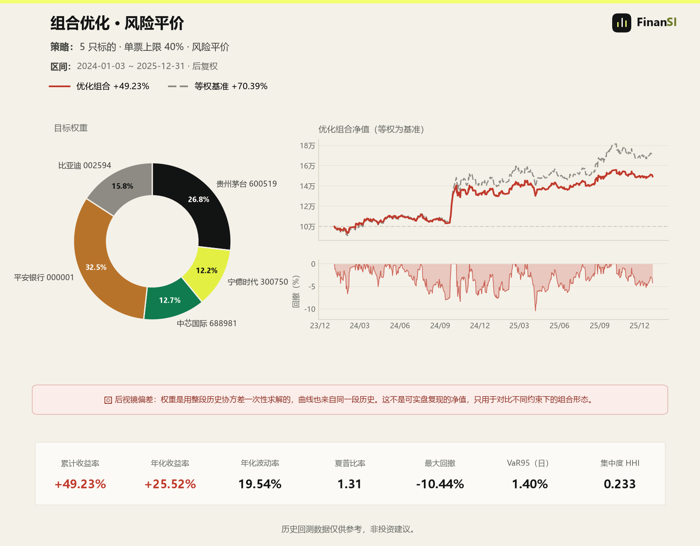

# A股组合风险与权重

**A股组合风险与权重**：输入一组持仓或候选股票，评估波动、回撤、VaR/CVaR、相关性和集中度，或按最小方差、风险平价、等权配置权重，并输出目标权重与对比图。

## 安装

```bash
git clone https://github.com/LINZIQI24GITHUB/finansi-a-share-portfolio.git
```

放到 Agent 的 skills 目录：

```text
Claude Code   ~/.claude/skills/finansi-a-share-portfolio/
Codex         ~/.codex/skills/finansi-a-share-portfolio/
Cursor        ~/.cursor/skills/finansi-a-share-portfolio/
通用           ~/.agents/skills/finansi-a-share-portfolio/
```

依赖：

```bash
cd finansi-a-share-portfolio
python -m venv .venv
.venv\Scripts\activate        # Windows
source .venv/bin/activate     # macOS / Linux
pip install -r requirements.txt
```

## 快速开始

```bash
# 评估已有持仓：holdings.csv 需要 code,weight 两列
python scripts/run.py analyze \
  --holdings holdings.csv --start 2024-01-01 --end 2025-12-31

# 从 5 只股票里配组合，单票不超过 40%
python scripts/run.py optimize \
  --codes "600519,300750,688981,000001,002594" \
  --start 2024-01-01 --end 2025-12-31 \
  --method minvar --max-weight 0.4
```

也可以直接对 Agent 说：

```text
用 finansi-a-share-portfolio 评估我这个持仓的风险，并按风险平价重新配权重。
```

## 输出

- 年化收益、波动率、夏普、最大回撤
- VaR / CVaR
- 集中度 HHI
- 相关性矩阵
- 目标权重与等权对比
- 组合图（默认生成，`--no-plot` 可关）：左边是权重环形图（带股票简称与代码），
  右边是优化组合净值与等权基准、回撤；中间一条红带写明后视镜偏差



图上左侧环形图是权重（含股票简称），右上为净值与等权基准，右中为回撤；
中间红带是后视镜偏差提示——权重由整段历史协方差一次性求解，这条曲线不是可实盘复现的净值。

## 方法

```text
minvar       最小方差
riskparity   风险平价
equal        等权
```

`--max-weight` 控制单票上限，默认 0.4。

## 边界

- 只做日频、多头组合；不做空、杠杆、行业中性。
- 历史协方差矩阵不代表未来；优化结果对区间和样本非常敏感。
- 不处理交易成本、税费、停牌和流动性冲击。
- 不构成投资建议。

## License

MIT. See [LICENSE](LICENSE).
